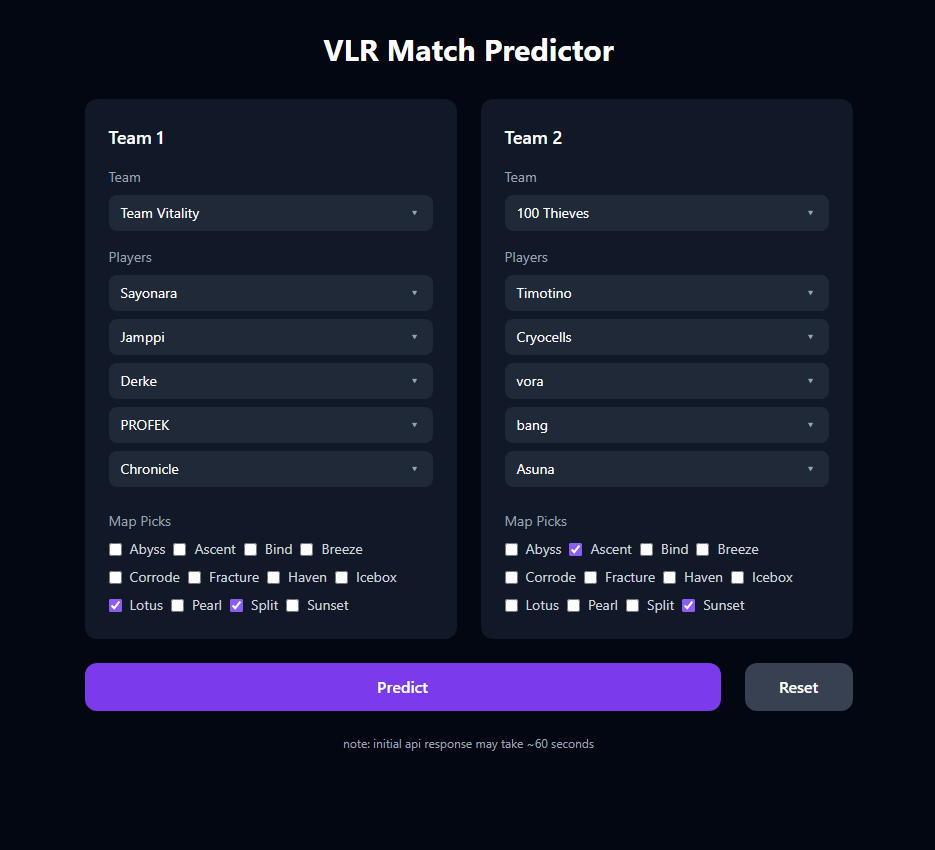
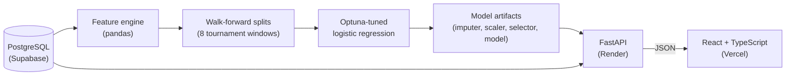
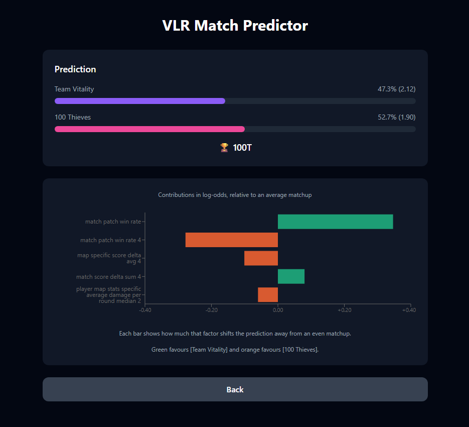

# VLR Predictor

An end-to-end machine learning project that predicts the winner of professional VALORANT matches. Pick two teams, their players and their map picks, and the app returns a win probability for each team and the five features that pushed the prediction most.

**Live demo:** [vlr-predictor.vercel.app](https://vlr-predictor.vercel.app) (free-tier hosting, so the first prediction can take a while as the API wakes up)



## Results

Evaluated with walk-forward validation over 8 held-out tournaments, where every model is trained only on matches played before the test tournament:

| Model | Accuracy | Log-loss | Brier |
|---|---|---|---|
| **Logistic regression (this project)** | **61.3%** | **0.685** | **0.245** |
| Favourite (higher win rate wins) | 57.5% | 1.964 | 0.417 |
| Random | 53.5% | 0.905 | 0.310 |
| Elo (k=32) | 52.4% | 0.838 | 0.295 |
| Head-to-head record | 51.1% | 2.259 | 0.480 |

The model beats every baseline on all three metrics. The honest caveat is that its log-loss (0.685) is only slightly better than predicting 50/50 for every match (0.693). Top-level VALORANT matches are close to coin flips, and the main value of the model is in the matches where the gap between teams is real. On the validation data its confidence is reasonably calibrated: when it gives the favourite 70-80%, the favourite wins about 73% of the time.

## How it works



### Data
Professional matches from VCT events between 2023 and 2026, with map results, team round statistics, per-player map statistics and player head-to-head records, stored in PostgreSQL through SQLAlchemy models (`db/models.py`). The data collection code is not included in this repository.

### Features (`ml/features/`)
A `FeatureEngine` coordinates five feature generators, each built on a shared `BaseFeatures` abstract class: match history, map results, team map stats, player map stats and player head-to-head.

- Every feature only uses matches played before the match being predicted, so no future information leaks into training.
- Features are computed over several recent-form windows (last 2, 4 and 6 matches, as well as all history) and, where it makes sense, filtered to the specific map and game patch.
- Each feature is computed for both teams and as the difference between them. 1,065 columns in total, of which the 355 `delta_` (team 1 minus team 2) features are used for modelling.
- The same `FeatureEngine` is used for training and for live predictions in the API, so the model sees features built in exactly the same way in both.

### Validation (`ml/create_splits.ipynb`)
Random train/test splits would let the model learn from future matches, so each window uses a tournament as its test set, the regional events before it as validation, and everything earlier as training. The 8 test tournaments run from VALORANT Champions 2024 to VCT 2026 Stage 2.

### Model (`ml/optuna_lr_delta_30.ipynb`)
Each window is trained independently, using only its own training data:

1. **Fill missing values.** `KNNImputer` fills gaps using similar matches from the training set.
2. **Shortlist features.** An initial logistic regression is fitted on all 355 delta features, and the 30 with the largest coefficients are kept.
3. **Tune the model.** Optuna runs 500 trials to choose the regularisation strength and the balance between L1 and L2 regularisation. Each trial is scored by log-loss using 5-fold cross-validation within the training data.
4. **Train and test.** The features are standardised, near-constant ones are dropped, and the final model is trained with the best settings, then evaluated on that window's test tournament.

The deployed model comes from the most recent window. It uses 23 features, and the regularisation set 7 of their weights to zero, so 16 actually affect its predictions.

I also tried XGBoost (`ml/optuna_xgb.ipynb`) and polynomial features (`ml/optuna_lr_delta_poly.ipynb`); neither beat the regularised linear model, which suggests the signal in these features is mostly linear.

### Explaining predictions
The API returns the five features that contributed most to each prediction, shown as a chart in the UI. Because the model is linear, each contribution is calculated exactly as `coefficient × (feature value − training mean)` in log-odds.



## Tech stack

| Area | Technologies |
|---|---|
| ML | Python, pandas, NumPy, scikit-learn, Optuna, Jupyter |
| Back end | FastAPI, Pydantic, SQLAlchemy |
| Database | PostgreSQL |
| Front end | React, TypeScript, Tailwind, Recharts, Vite |
| Hosting | Render, Vercel, Supabase |

## Project structure

| Folder | Contents |
|---|---|
| `backend/` | FastAPI app. Loads the data and model artifacts on startup and serves `/teams`, `/players`, `/maps` and `/predict` |
| `db/` | SQLAlchemy models and the database connection |
| `ml/features/` | `FeatureEngine` and the five feature generators |
| `ml/` | Elo baseline and notebooks: splits (`create_splits`), the final model (`optuna_lr_delta_30`), benchmarks and experiments |
| `frontend/` | React + TypeScript |

## Running locally

**Prerequisites:** Python 3.13, Node 22 and a PostgreSQL database with the project schema.

### API
```bash
cp .env.example .env          # then set DATABASE_URL
python -m venv .venv
source .venv/bin/activate     # Windows: .venv\Scripts\activate
pip install -r backend/requirements.txt
pip install -e .
python -m uvicorn backend.main:app
```
Run it from the project root. The API runs at `http://127.0.0.1:8000`, with interactive docs at `/docs`.

### Front end
```bash
cd frontend
npm ci
npm run dev
```
The front end runs at `http://localhost:5173` and calls the local API by default (set `VITE_API_BASE_URL` to point it elsewhere).

## Limitations

- **Small test sets.** Each test tournament has between 24 and 180 predictions, so per-window accuracy varies a lot (55% to 79%). The pooled figure across all 8 windows is the one to trust.
- **Early windows have less history.** The earliest windows are trained on the fewest matches and have the worst log-loss. I kept them in the evaluation rather than dropping them, because removing the worst-performing windows after seeing the results would inflate the score.
- **Roster changes aren't modelled.** Teams are identified by ID, and at prediction time you choose the five players, but the training data doesn't account for roster changes between matches.
